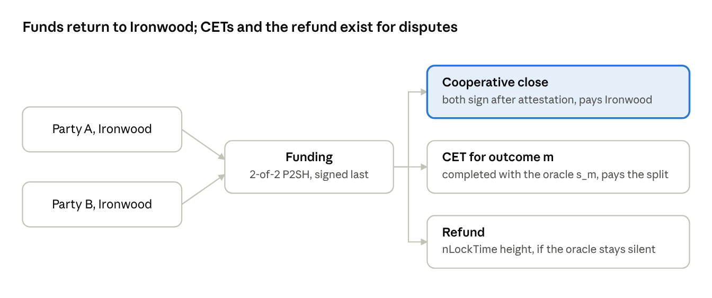

# zdlc design

## The concept

**zdlc is oracle-settled contracts on Zcash, entered and exited through Ironwood.** Two parties lock ZEC in a transparent 2-of-2 for the life of one contract. Before funding, they pre-sign one payout per outcome and a refund; the oracle's signature makes exactly one payout valid. Normally neither is used, because both parties close straight back to Ironwood.

| Part | What it is |
| --- | --- |
| Contract | A 2-of-2 P2SH output, adaptor-signed payouts, a refund at a fixed height |
| Oracle | BIP-340 attestations; later two TEE enclaves acting as a 2-of-2 multi-oracle |
| Privacy wrapper | Ironwood in and out, an encrypted memo record for seed recovery, attestations of shielded payments |

Five rules hold everywhere:

1. Sign every payout and the refund before funding.
2. Close cooperatively to Ironwood; payouts are the dispute path only.
3. Never span a network upgrade: maturity and refund fall before the next activation height.
4. Build every transaction as v6; bake the fee in and set nExpiryHeight to 0 on every pre-signed one.
5. Two parties per contract, fully collateralized.

Three product lines sit on top:

- **Hedged payments.** Stable-value invoices, payroll and remittances.
- **Private OTC.** Forwards, spreads and binaries quoted over an RFQ desk.
- **Conditional payments.** Escrow, parametric insurance and agent outcome payments, gated by a price, an event or a shielded payment.

Out of scope until proven: channels and in-place rolling, shielded payouts, fully shielded contracts, transferable positions and proof-based settlement. Each is on the research track.

## The shared base

Every contract is one 2-of-2 output, one pre-signed payout transaction (CET) per outcome, one pre-signed refund, and an oracle that signs once. Nothing here is new protocol; it is the dlcspecs flow on a Zcash transaction builder.

### The oracle's commitment

Before the event, the oracle announces its public key P, a nonce point R, the event ID and its maturity. For any outcome m, anyone can compute the point the oracle's future signature will reveal:

```latex
S_m = R + H(R \,\|\, P \,\|\, m)\cdot P \qquad s_m \cdot G = S_m
```

Publishing the BIP-340 signature for m reveals the scalar s_m. That scalar is the key that unlocks exactly one CET.

### Setup: offer, accept, sign

1. **Offer.** A sends the contract terms (outcomes and payouts), the announcement, its collateral, its funding inputs, its payout script and the refund height.
2. **Accept.** B returns its inputs and keys, an ECDSA adaptor signature on every CET encrypted to that CET's S_m, and a plain signature on the refund.
3. **Sign.** A verifies everything, returns its own adaptor signatures and refund signature, and only then signs the funding inputs.
4. **Broadcast.** The funding transaction goes out last. Neither side can lose its collateral before holding every CET and the refund.

### The four transactions

| Transaction | Spends | Pays | Signed | Notes |
| --- | --- | --- | --- | --- |
| Funding | Each party's collateral, from Ironwood | P2SH `2 <A> <B> 2 CHECKMULTISIG` | Last, after all others | Fresh keys per contract |
| Cooperative close | Funding | Each party's Ironwood address | After the attestation, by both | The normal path; no CET reaches the chain |
| CET, one per outcome | Funding | That outcome's split | At setup, as adaptor signatures | Completed by whoever holds s_m; transparent outputs, so no proofs at setup; nExpiryHeight 0 |
| Refund | Funding | Each party's collateral back | At setup | nLockTime = refund height; nExpiryHeight 0 |



Only the funding and one way out ever reach the chain; in the normal case that is the cooperative close.

### Settlement

When the oracle publishes s_m, either party decrypts the counterparty's adaptor signature on CET m into a valid ECDSA signature, adds its own and can broadcast. In practice both first try the cooperative close, which is cheaper and pays Ironwood directly. If the oracle never signs, the refund becomes valid at its height; it must sit well after maturity plus the oracle's expected delay, or the refund and a late CET race.

## What Zcash changes

Single contracts port cleanly; channels and anything that must survive a network upgrade do not. Platform facts are from the ztxo round design (verified 2026-10-08); pczt facts are from its 0.10.0-pre.1 source (read 2026-10-20).

| Zcash fact | Effect on DLCs | Handling in zdlc |
| --- | --- | --- |
| P2SH and CLTV only, no CSV | Refunds are fine (nLockTime on a pre-signed tx). dlcspecs channels use CSV buffer transactions and do not port | Single contracts first. Rolling contracts roll on chain, or wait for a fixed-lifetime channel built on absolute heights, as in ztxo's height ladder |
| Sighash commits to the consensus branch ID (ZIP 244, kept in v6) | Every CET and the refund become invalid when the next upgrade activates | Maturity and refund height must fall before the next activation height, or every transaction is signed twice, once per branch ID. Rounds in ztxo already refuse to straddle `next_upgrade` |
| NU7 mainnet height due to be set Oct 20, 2026 (ZIP 259), 25 s blocks | Contracts that span NU7 hit the rule above, and heights mean different times on each side | Express the refund as a height computed per era; dual-sign or refuse contracts that span activation |
| librustzcash's Builder fixes nLockTime at 0; the pczt roles (0.10.0-pre.1) do not | The Builder cannot make the refund. pczt spends P2SH multisig, exposes each input's sighash, accepts an external signature and sets a per-input height lock time | Every transaction is v6, built through pczt: transparent_sighash for adaptor signing, append_transparent_signature for the decrypted signature. No custom builder |
| Each tx must pay the conventional fee alone; no RBF, no CPFP | A CET's fee is fixed at signing and cannot be bumped | ZIP 317 fee baked into every CET. A CET with one P2SH input and two P2PKH outputs is 2 logical actions: 10,000 zat, measured on regtest in Phase 0 |
| Relay limits: 15 sigops, scriptSig 1,650 B, dust 54 zat | A 2-of-2 spend is about 220 B and 2 sigops, well inside | CET payouts below 54 zat are dropped to the other side, as Bitcoin DLCs do with dust |
| nExpiryHeight on every tx | A pre-signed tx with a non-zero expiry silently dies | CETs and refund set nExpiryHeight to 0 (no expiry); the cooperative close uses a normal short expiry |
| ECDSA signatures must be low-S | pczt's Signer refuses a high-S signature | libsecp256k1-zkp's adaptor decrypt already returns low-S (Phase 0: 0 of 64); zdlc normalizes anyway |

The one branch-ID rule is the easiest to miss. A contract signed today under the Ironwood branch, with a refund height after NU7 activates, has a refund that can never confirm.

## Privacy model

The contract's existence and total are public; its terms, oracle and split stay private only while no CET reaches the chain. That makes the cooperative close the privacy path, and the CET the dispute path.

| Observer | Sees on the cooperative path | Sees if a CET is broadcast |
| --- | --- | --- |
| Public, on Zcash | Ironwood value leaving into a 2-of-2, then the same value returning to Ironwood | With transparent payouts: the exact split. For a numeric contract the split maps to a price, which can identify the oracle event |
| Oracle | Nothing; it signs outcomes for everyone alike | Nothing more, unless it scans the chain for splits that match its outcomes |
| Counterparty | Everything in the contract | The same |
| Matching venue (RFQ desk, G8 group) | Quotes and who accepted | The same |

Shielded CET outputs would hide the split even in a dispute. Whether that is affordable is the spike's question, because of four costs:

- **Proofs at setup.** Each CET needs its Ironwood actions proven before signing, since the sighash commits to its commitments and ciphertexts. A contract with hundreds of CETs means hundreds of proofs.
- **Size.** Every CET is stored by both parties until settlement; proofs multiply that storage.
- **One builder.** The binding signature needs the sum of all value-commitment randomness, so one party builds both outputs and must give the other the plaintext to check its own note.
- **Upgrade exposure.** A shielded CET is a v6 transaction, so the branch-ID rule applies with full force.

A middle tier is possible: shield the CETs for a coarse grid of outcomes and leave fine-grained ones transparent.

### Funding from two shielded wallets

The same one-builder problem hits a jointly funded output. Three options, cheapest to most private:

1. **One funder.** Only one party contributes, as in loans and commitment contracts. No joint construction.
2. **Deshield, then fund.** Each party first moves its collateral to its own transparent address, then both sign a transparent-only funding tx. Three transactions, and the two deshields are linkable to the 2-of-2.
3. **One joint transaction.** Both parties' Ironwood spends in one pczt. The finalizer must learn every party's value randomness, which reveals each side's input amounts to the other. Whether pczt's combiner supports this needs checking.

## Architecture tiers

Only tier A is buildable under today's consensus without adding trust; it is what this doc specifies. Tier C, a fully shielded DLC, is blocked by setup ordering, not by signatures.

| Tier | Collateral during the contract | What enforces the payout | Status |
| --- | --- | --- | --- |
| A. Shielded-entry DLC | Transparent 2-of-2 P2SH | Pre-signed CETs and refund | v1 |
| B. Proof-carrying DLC | A vault | Signers who check a ZK proof that the payout follows from private inputs | Buildable, but the signers are trusted; a custody design rather than a DLC |
| C. Shielded conditional note | A shielded note under a 2-of-2 FROST key | Pre-signed shielded payouts with RedPallas adaptor signatures | Research |

### Why tier C is blocked

An Ironwood spend is proven against an anchor, and the ZIP 244 digest commits to that anchor. Payouts and the refund can therefore only be proven and signed after the funding note is mined.

- **The safety order flips.** In tier A you hold every CET and the refund before funding. In tier C you fund first, so a counterparty who stops responding holds both stakes hostage: griefing, not theft, but unbounded.
- **The refund has no timelock.** As far as the consensus code reads, nLockTime is not enforced on a transaction with no transparent inputs. A tiny transparent input with a non-final sequence restores it, at a small privacy cost.
- **The oracle must sign over Pallas.** No Bitcoin oracle does; the TEE oracle network could.

The research question stays open: an oracle-conditioned, independently enforceable transfer of ZEC that reveals neither the outcome nor a long-lived transparent output. Mutual hostage between bonded, reputable parties is the only near-term compromise.

### Relation to ztxo

zdlc shares ztxo's rules (absolute-height timelocks, the upgrade rule and memo backup), builds v6 through pczt instead of ztxo's v5 encoder, and needs no ztxo server for a two-party contract. The two meet in the user–hub 2-of-2 vault: there the hub is the counterparty, and the credit inside the vault is a zdlc contract. Independent exit must be demonstrated before either is called trustless custody.
