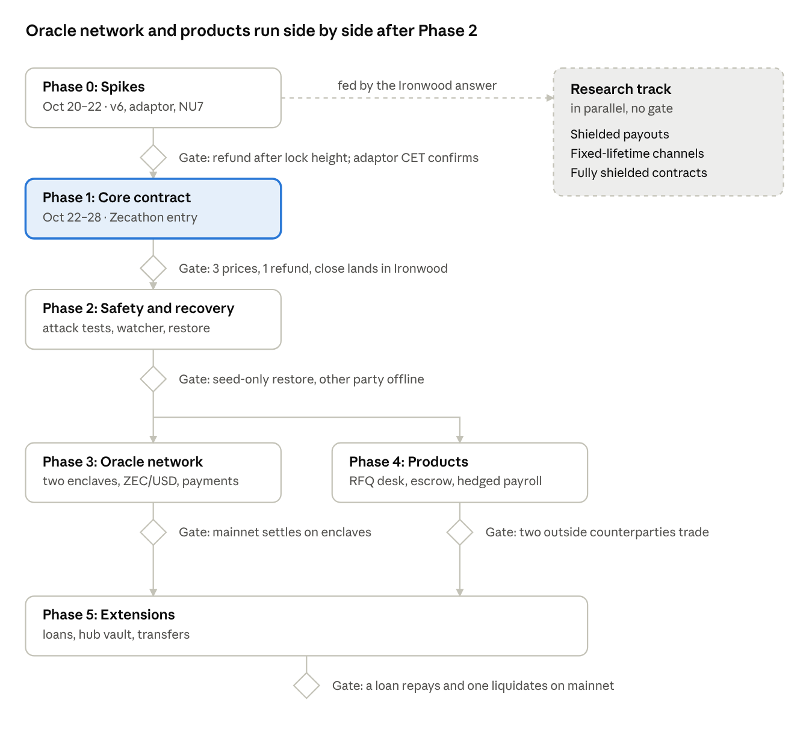

# zdlc plan

## Phased plan

Six phases, each ending at a gate. A phase starts when the gates it depends on pass, so the oracle network (3) and the products (4) run side by side. Phase 1 is the Zecathon entry, due Oct 28, in the Shielded Payments track. Every transaction is v6, built through pczt, and every test runs on Zakura regtest.

### Phase 0: spikes (Oct 20–22)

- [x] Builder: a v6 transaction spending the P2SH 2-of-2 through pczt, its signatures added with `append_transparent_signature` and its lock time set per input.
- [x] Adaptor path: adaptor-sign the input's `transparent_sighash`, decrypt with an oracle scalar, normalize to low-S, append and finalize.
- [x] Ironwood: a v6 transaction with only transparent inputs paying an Ironwood output. This is the cooperative close.
- [x] NU7: a v6 CET signed under NU6.3's branch ID (37a5165b) is rejected after activation; the same CET signed under NU7's (77190ad9) is accepted. Run on regtest configs from before and after NU7.
- [x] Dependencies: pin a rust-dlc commit; check that dlc-trie and secp256k1-zkp build beside pczt, and whether dlc-trie pulls in the Bitcoin `dlc` crate.

**Gate:** on Zakura regtest, a refund confirms after its lock height and not before, and an adaptor-completed CET confirms.

**Passed 2026-10-20.** Results: [spikes/phase0.md](spikes/phase0.md).

### Phase 1: core contract (Oct 22–28)

1. Dev oracle: a BIP-340 announce and attest tool, one nonce per digit.
2. Setup end to end on a small enumerated contract: offer, accept, sign, fund, attest, settle, then the refund path. This is plumbing for step 3, not a deliverable.
3. Numeric stable-value contract on dlc-trie with a coarse payout curve (about 10 to 12 binary digits, wide rounding) to keep CET count and signing time small.
4. CETs and the refund pay transparent outputs; the cooperative close pays Ironwood in one v6 transaction. If Phase 0 finds Ironwood inflows barred, close to transparent and shield after.
5. Upgrade guard: refuse a contract whose maturity or refund height crosses the next activation height.
6. Demo and write-up, with the spike results and the branch-ID rule. The hedger funds from transparent on regtest; deshield-then-fund is described, not built.

**Gate:** on regtest the stable-value demo settles at three prices, refunds once, and its cooperative close lands in Ironwood.

### Phase 2: safety and recovery (after Phase 1)

- Adversarial tests: a refund racing a late CET, a wrong branch ID, dust payouts, high-S signatures, a counterparty who stops mid-setup.
- Chain watcher on Zakura's JSON-RPC: stores CETs, watches the funding output, and broadcasts the refund at its height when a party is offline.
- Memo recovery record and seed-only restore.
- Dual-signed CET and refund sets, one per branch ID, as the alternative to refusing contracts that span an activation.
- Testnet, then mainnet with a per-contract cap. The oracle is a single operator oracle, trusted to sign honestly, until Phase 3 replaces it.

**Gate:** a wallet restored from its seed alone recovers its collateral at the refund height while the other party is offline.

### Phase 3: oracle network (after Phase 2)

- Two TEE enclaves as a 2-of-2 multi-oracle, each with a sealed nonce counter.
- Feeds: ZEC/USD first, then shielded-payment attestations from the viewing-key scanner.
- A compatibility test against an existing dlcspecs oracle for BTC-referenced contracts.

**Gate:** a mainnet contract settles on enclave attestations alone.

### Phase 4: products (after Phase 2, beside Phase 3)

- RFQ desk over G8 or Nostr, with memo invitations and self-expiring quotes. It runs on the operator oracle until Phase 3's gate passes.
- Conditional payments: milestone escrow first, then agent outcome payments once the shielded-payment feed exists.
- Hedged payroll: a monthly stable-value contract, rolled on chain.

**Gate:** two counterparties other than you trade through the desk.

### Phase 5: extensions (after Phases 3 and 4)

- Loans against ZEC collateral, with the Solana repayment oracle.
- The user–hub vault with ztxo, where the hub is the counterparty.
- Novation-based position transfer and on-chain rolling forwards.

**Gate:** on mainnet one loan repays and one liquidates, each settled on enclave attestations.

### Research track (in parallel, no gate)

- Shielded payouts: proof time and size per CET, whether a CET held for weeks survives the anchor rule, and one party building both outputs. Starts from Phase 0's Ironwood answer.
- Fixed-lifetime channels on absolute heights.
- Fully shielded contracts (tier C).

## Open questions

Unverified facts:

- The NU7 mainnet activation height, due to be set Oct 20, 2026, which caps maturity for every contract signed before it.
- Whether pczt can combine two parties' Ironwood spends into one funding transaction, and what each side then learns.
- Whether an Ironwood output's ciphertext is byte-for-byte reproducible from its plaintext.
- Which existing dlcspecs oracles are still live, and whether their announcement format matches rust-dlc's.

Answered in Phase 0 ([spikes/phase0.md](spikes/phase0.md)):

- Ironwood accepts outputs from a transaction with only transparent inputs, under NU6.3 and NU7.
- `append_transparent_signature` verifies each signature and refuses high-S. The Updater cannot set an input's sequence or lock time, so zdlc rebuilds the bundle with `Input::parse`.
- secp256k1-zkp is on secp256k1 0.29 and pczt on 0.33; both build together, and signatures cross as compact bytes.

Design choices:

- The refund split for escrow and loans, where a full refund to one side punishes the other for the oracle's silence.
- Rounding intervals and digit base: CET count against payout precision.
- Whether shielded CETs are worth their setup cost, even for a coarse grid.
- The fixed-lifetime channel design for rolling contracts without CSV.
- How the RFQ desk keeps quotes firm without locking makers' inputs for long.
- Who makes markets on the RFQ desk at first, if not you.

Research:

- Tier C setup ordering: any way to hold a valid shielded refund before the funding note exists.
- Whether nLockTime is enforced on a transaction with no transparent inputs.
- A transfer of a position that does not need the counterparty.

## Sources

- `ztxo/round-design.md` v0.3 (2026-10-08): Zcash platform facts, builder limits, upgrade rule.
- `pczt` 0.10.0-pre.1 and `zcash_transparent` 0.11.0-pre.1 crate source (read 2026-10-20): v6 Creator, P2SH multisig spend finalizer, `transparent_sighash`, `append_transparent_signature`, per-input height lock time.
- [dlc-manager numerical descriptor source](https://docs.rs/crate/dlc-manager/latest/source/src/contract/numerical_descriptor.rs) (docs.rs, seen via search, not opened).
- [dlc-trie crate docs](https://docs.rs/dlc-trie/latest/dlc_trie/) (docs.rs, seen via search, not opened).
- [ddk-trie crate docs](https://docs.rs/crate/ddk-trie/latest) (docs.rs, seen via search, not opened).
- DLC protocol details (adaptor signatures, offer, accept, sign, digit decomposition) are from memory of the dlcspecs repository and should be checked against it.
